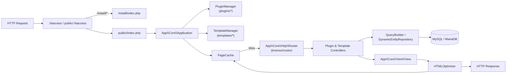

<div align="center">

# Groo (`groo/core`)

**Extensible PHP 8.0+ Plugin- and Template-Based CMS & CRM Core**

Lightweight, PSR-4 modular web platform combining a custom PHP front-controller kernel, JSON-backed dynamic entity engine, pluggable business modules (CMS, CRM, Media, SEO, Traffic, User Management), and swappable storefront templates.


</div>

> **Pre-Release Security & Readiness Notice:** Groo is an active pre-release codebase. Before deploying publicly or publishing this repository as open source, review the known security findings, client-asset separation requirements, and follow-up remediation plan in [`docs/github-readiness/FINAL_REPORT.md`](docs/github-readiness/FINAL_REPORT.md) and [`SECURITY.md`](SECURITY.md).

---

## Project Overview

Groo (`groo/core`) is a minimalist PHP 8.0+ application core built to power modular content websites and internal back-office workflows without heavy framework overhead. It depends on only two direct Composer packages (`bramus/router` and `vlucas/phpdotenv`) and organizes every domain feature as an isolated PSR-4 plugin under `plugins/` alongside swappable storefront themes under `templates/`.

**Core technical characteristics verified in source:**

- **Minimal Footprint:** ~649 KB across 173 PHP files (`declare(strict_types=1)` across core and plugin classes).
- **Hybrid Storage Model:** Combines relational MySQL tables (`um_*`, `crm_*`, `seo_*`, `traffic_*`, `media_library`, `error_pages`) with a JSON-backed dynamic entity engine (`entities`, `attributes`, `entity_records`) queryable via MySQL `JSON_EXTRACT`.
- **Modular Plugin Lifecycle:** Automatic plugin discovery under `plugins/`, environment-controlled activation (`ACTIVE_PLUGINS`), dependency resolution (`requires`), route groups, and event/hook extensibility.
- **Template Isolation:** Single active storefront theme (`ACTIVE_TEMPLATE`) with plugin dependency checks, layout/section PHP rendering, and built-in `/assets` and `/media/view` asset streaming.

---

## Screenshots & Visual Showcase

Curated, sanitized screenshots of the clean `default` theme and admin panel have not yet been captured. The only visual assets currently in the workspace belong to a client deployment (`templates/DualTesisat/`) and are intentionally omitted here.

A dedicated [`docs/assets/`](docs/assets/README.md) directory is prepared with a capture checklist covering the setup wizard, admin dashboard, block-based post editor, CRM tasks/finance views, SEO manager, and traffic analytics charts.

---

## Features

All capabilities below reflect actual verified implementations in the codebase:

### Core Framework (`app/Core/`)

| Feature | Status | Notes |
|---|---|---|
| PSR-4 Front Controller & Config Loader (`Application`, `Config`) | **Implemented** | Loads `.env` via `vlucas/phpdotenv` and `app/Config/*.php` with dot-notation lookup. |
| HTTP Router & Middleware Pipeline (`Router`, `ApiResponse`) | **Implemented** | Wraps `bramus/router` with `{param:regex}` patterns, route groups, and JSON responses. |
| PHP View Engine (`View`) | **Implemented** | Single-level layout inheritance (`extend`/`section`), partials, HTML escaping (`e()`), URL helpers, and `records()`. |
| Plugin & Template Managers (`PluginManager`, `TemplateManager`) | **Implemented** | Auto-discovery, topological plugin dependency ordering, hotlink-checked asset serving. |
| Dynamic Entity Engine (`DynamicEntityRepository`) | **Partially Implemented** | Schema/record CRUD and MySQL JSON queries work; `null` bypasses `required` checks. |
| Database QueryBuilder & Migrations (`QueryBuilder`, `MigrationManager`) | **Partially Implemented** | Simple CRUD and numbered forward migrations work; lacks joins/transactions/identifier quoting and has a scope collision between installers. |
| Full-Page HTML Cache (`PageCache`) | **Experimental** | File-based GET cache in `storage/cache/html/`; lacks TTL/size caps and Content-Type filtering. |
| HTML & Image Optimizer (`HTMLOptimizer`) | **Experimental** | Injects `loading="lazy"`, `decoding="async"`, and `<script defer>`; `/public` path resolution and CSS `url()` WebP rewrites require fixes. |

### Included Plugins (`plugins/`)

| Plugin | Status | Summary |
|---|---|---|
| `Admin` | **Implemented** *(Security Fixes Needed)* | Admin shell, login/rate-limiting, dashboard, dynamic entity CRUD, plugin toggle, ZIP theme/plugin installer. *(See RBAC and Zip Slip findings in `REPOSITORY_AUDIT.md`.)* |
| `Content` | **Implemented** | Block-based blog/post editor (text, image, raw HTML blocks), `ContentHelper`, and public JSON API (`/api/content/posts`). |
| `Crm` | **Implemented** | Contacts + activity timeline, tasks & calendar grid, task types, invoices/expenses, notifications, and dashboard widgets. |
| `Media` | **Implemented** *(Security Fixes Needed)* | Media library, GD WebP conversion, responsive (`480w`/`768w`) theme asset optimizer. *(Upload fallback hardening tracked in WP-1.)* |
| `Traffic` | **Implemented** | Request/bot logger (`BotDetector`), page quality scoring (`ScoreCalculator`), and Chart.js dashboard. |
| `UserManagement` | **Partially Implemented** | Users, roles, and admin CRUD work; Bearer `/api/me` endpoint and self-account update require bug fixes. |
| `SEO` | **Partially Implemented** | Meta/OG/JSON-LD helper and `/robots.txt` + `/sitemap.xml` routes exist; settings upsert, blog sitemap query, and `seo_redirects` require fixes. |
| `ErrorPages` | **Partially Implemented** | Front-end custom error page rendering works via `core.exception.render`; admin editor view path registration needs a fix. |
| `Demo` | **Experimental / Sample** | Sample greeting and dynamic entity API endpoints. **Keep disabled in production.** |
| `DualContact` | **Client-Specific** | Contact form inbox tied to `templates/DualTesisat/`. Scheduled for extraction out of `groo/core`. |
| `Install` (`plugins/Install`) | **Deprecated** | Legacy plugin-based installer (`/system-install/`) superseded by `install/index.php`. **Keep disabled.** |

### Setup & Templates

| Component | Status | Summary |
|---|---|---|
| Standalone Setup Wizard (`install/index.php`) | **Partially Implemented** | 4-step web installer (checks, `.env` + DB migrations, initial admin account, optional self-destruct). |
| Default Template (`templates/default/`) | **Implemented** | Minimal standalone welcome landing page requiring no plugins. |
| DualTesisat Template (`templates/DualTesisat/`) | **Client-Specific** | Corporate site template scheduled for extraction to a separate repository before public release. |

---

## Architecture

Groo routes HTTP traffic through Apache `.htaccess` rules into `public/index.php`, bootstraps plugins and the active template in `App\Core\Application`, and executes requests through `PageCache`, `Router`, controllers, `View`, and `HTMLOptimizer`.



For the complete subsystem breakdown, execution lifecycle, and known architectural caveats, see [`docs/architecture/ARCHITECTURE.md`](docs/architecture/ARCHITECTURE.md).

---

## Technology Stack

| Category | Technologies |
|---|---|
| **Language & Runtime** | PHP `>= 8.0` (`strict_types=1`), PDO (`pdo_mysql`), JSON, Session, Fileinfo, XMLWriter, GD *(optional)*, ZipArchive *(optional)* |
| **Composer Packages** | `bramus/router` (`^1.6`), `vlucas/phpdotenv` (`^5.6`) |
| **Database** | MySQL `8.0+` / MariaDB `10.4+` (`utf8mb4`, `JSON` column support) |
| **Web Server** | Apache `2.4+` (`mod_rewrite`, `mod_headers`, `mod_expires`) |
| **Frontend (Admin & Templates)** | Vanilla JavaScript, custom admin CSS, Tailwind Play CDN, Google Fonts (`Inter`), Chart.js, ApexCharts |
| **CI / Quality Automation** | GitHub Actions (`.github/workflows/ci.yml`, `.github/workflows/code-quality.yml`) |

---

## Repository Structure

```text
.
├── .github/workflows/       # GitHub Actions CI & hygiene workflows
├── app/
│   ├── Config/              # Environment-backed config files (app, db, plugins, templates)
│   └── Core/                # Kernel, Router, View, Database, Events, Hook, Middleware, Plugin/Template managers
├── docs/
│   ├── architecture/        # Detailed system architecture guide
│   ├── assets/              # Visual showcase placeholder & screenshot guidelines
│   ├── development/         # Local build/setup and testing guides
│   └── github-readiness/    # Discovery, audit, cleanup, validation, backlog, and final reports
├── install/                 # Standalone 4-step web installer and SQL migrations (001..007)
├── plugins/                 # Modular PSR-4 plugins (Admin, Content, Crm, Media, SEO, Traffic, UserManagement, etc.)
├── public/                  # Web server document root (index.php, .htaccess, robots.txt, uploads/.htaccess)
├── storage/                 # Writable runtime cache and temporary ZIP extraction folders
├── templates/               # Frontend storefront themes (default, DualTesisat)
├── .editorconfig            # Editor formatting standards
├── .env.example             # Documented environment template
├── .gitattributes           # Cross-platform line-ending and binary rules
├── .gitignore               # Exclusion rules for secrets, vendor/, caches, and uploads
├── .htaccess                # Root Apache security and rewrite rules
├── CODE_OF_CONDUCT.md       # Contributor Covenant 2.1
├── CONTRIBUTING.md          # Contribution and coding guidelines
├── SECURITY.md              # Vulnerability disclosure and deployment hardening policy
├── SUPPORT.md               # Issue reporting and support guidance
├── composer.json            # Package metadata, PHP requirement, and PSR-4 autoloading
└── composer.lock            # Pinned Composer dependency graph
```

---

## Requirements

- **Operating System:** Linux, macOS, or Windows (development has occurred on Windows/XAMPP; CI targets Ubuntu Linux).
- **PHP:** `>= 8.0` (CI validates `8.1`, `8.2`, `8.3`).
- **Required PHP Extensions:** `pdo`, `pdo_mysql`, `json`, `session`, `filter`, `fileinfo` (Media), `xmlwriter` (SEO).
- **Optional PHP Extensions:** `mbstring` (polyfilled if absent), `gd` (WebP & responsive image generation), `zip` (ZIP plugin/theme installer).
- **Database:** MySQL `8.0+` or MariaDB `10.4+` with `utf8mb4` and `JSON` support.
- **Web Server:** Apache `2.4+` with `mod_rewrite`, `mod_headers`, and `mod_expires` enabled.
- **Dependency Manager:** Composer `2.x`.

---

## Installation & Build

> **Validation Transparency:** PHP, Composer, Apache, and MySQL were not installed in the audit environment used to prepare this documentation. The commands below are verified against `composer.json`, `.env.example`, `.htaccess`, `public/index.php`, and `install/index.php`, and must be executed in a PHP 8.0+ environment.

1. **Clone the repository and install Composer dependencies:**

   ```bash
   git clone <repository-url> groo
   cd groo
   composer install
   ```

2. **Create and configure `.env`:**

   ```bash
   cp .env.example .env
   ```

   Update `DB_HOST`, `DB_PORT`, `DB_DATABASE`, `DB_USERNAME`, and `DB_PASSWORD` in `.env`. Keep `ACTIVE_PLUGINS` explicitly set (do not leave it blank).

3. **Configure Apache & Run the Web Installer:**
   - Verify write permissions on `storage/cache/`, `storage/temp/`, `public/uploads/`, and `.env`.
   - **During initial installation (`APP_INSTALLED=false`):** Because `install/` sits alongside `public/`, either serve `<project-root>` via the root `.htaccess` (which protects internal folders while routing `/install` and rewriting everything else to `public/`) or temporarily add an Apache `Alias /install <project-root>/install` to a VirtualHost pointing at `public/`.
   - Open `http://<your-host>/install/index.php` and complete the 4-step wizard to execute core migrations and create the initial administrator account.
   - **After installation (`APP_INSTALLED=true`):** Delete the `install/` directory on any non-local server and point your production Apache VirtualHost `DocumentRoot` directly to `<project-root>/public`.

For detailed instructions (including PHP built-in server notes and `media_library` auto-migration behavior), see [`docs/development/BUILDING.md`](docs/development/BUILDING.md).

---

## Usage / Quick Start

Once installed (`APP_INSTALLED=true`):

- **Storefront Home:** Visit `http://<your-host>/` (renders the template set in `ACTIVE_TEMPLATE`, defaulting to `default`).
- **Admin Control Panel:** Visit `http://<your-host>/admin/login` (or `/<ADMIN_PATH>/login`) and sign in with the administrator account created during installation.
- **Public Content API:** Query published blog posts via JSON:

  ```bash
  curl http://<your-host>/api/content/posts/
  ```

- **Creating a Minimal Plugin:** Place a PSR-4 class extending `App\Core\Plugin\AbstractPlugin` at `plugins/Example/ExamplePlugin.php`, add `example` to `ACTIVE_PLUGINS` in `.env`, and register routes in `plugins/Example/Routes/routes.php`:

  ```php
  <?php

  declare(strict_types=1);

  namespace Plugins\Example;

  use App\Core\Plugin\AbstractPlugin;

  final class ExamplePlugin extends AbstractPlugin
  {
      public function getMetadata(): array
      {
          return [
              'name' => 'Example',
              'slug' => 'example',
              'version' => '1.0.0',
              'description' => 'Minimal example plugin',
              'requires' => [],
              'route_prefix' => '/example',
          ];
      }
  }
  ```

---

## Testing

No automated unit or integration test suite (`tests/` / PHPUnit) is currently implemented in this repository.

Available static validation commands (executed automatically by GitHub Actions on PHP `8.1`, `8.2`, and `8.3`):

```bash
# Validate composer.json and composer.lock
composer validate --strict

# Audit Composer dependencies for security advisories
composer audit

# Syntax-lint all PHP files
find app install plugins public templates -type f -name '*.php' -print0 | xargs -0 -n1 php -l
```

See [`docs/development/TESTING.md`](docs/development/TESTING.md) for Windows PowerShell commands and the manual smoke-test checklist.

---

## Documentation

| Category | Document |
|---|---|
| **Index** | [`docs/README.md`](docs/README.md) |
| **Architecture** | [`docs/architecture/ARCHITECTURE.md`](docs/architecture/ARCHITECTURE.md) |
| **Setup & Build** | [`docs/development/BUILDING.md`](docs/development/BUILDING.md) |
| **Testing & Validation** | [`docs/development/TESTING.md`](docs/development/TESTING.md) |
| **Project Discovery** | [`docs/github-readiness/PROJECT_DISCOVERY.md`](docs/github-readiness/PROJECT_DISCOVERY.md) |
| **Repository Audit** | [`docs/github-readiness/REPOSITORY_AUDIT.md`](docs/github-readiness/REPOSITORY_AUDIT.md) |
| **Cleanup Report** | [`docs/github-readiness/CLEANUP_REPORT.md`](docs/github-readiness/CLEANUP_REPORT.md) |
| **Validation Report** | [`docs/github-readiness/VALIDATION_REPORT.md`](docs/github-readiness/VALIDATION_REPORT.md) |
| **Remediation Backlog** | [`docs/github-readiness/ADDITIONAL_WORK_PACKAGES.md`](docs/github-readiness/ADDITIONAL_WORK_PACKAGES.md) |
| **Final Readiness Review** | [`docs/github-readiness/FINAL_REPORT.md`](docs/github-readiness/FINAL_REPORT.md) |

---

## Roadmap

Verified status derived from the codebase audit and [`docs/github-readiness/ADDITIONAL_WORK_PACKAGES.md`](docs/github-readiness/ADDITIONAL_WORK_PACKAGES.md):

- **Completed:**
  - Modular PHP 8.0+ kernel, PSR-4 plugin/template managers, dynamic JSON entity repository, and core CMS/CRM/Media/Traffic/SEO/UserManagement modules.
  - Repository hygiene cleanup, Apache upload-execution guard (`public/uploads/.htaccess`), governance files, documentation suite, and GitHub Actions CI workflows.
- **In Progress / Required Before Public Release:**
  - Critical security remediation (RBAC fail-closed permissions, Media upload fallback removal, Zip Slip protection, CSRF/XSS/session hardening, locking down `Install`/`Demo`/`DualContact`).
  - Extraction of client-specific template/plugin (`DualTesisat`, `DualContact`) and assets from `groo/core`.
  - Maintainer confirmation and publication of a root `LICENSE` file.
- **Planned (Post-Hardening):**
  - Unifying `install/migrations/` and plugin migrations under one schema contract.
  - Fixing verified functional defects in `SEO`, `ErrorPages`, `UserManagement`, `ThemeController`, `HTMLOptimizer`, and `PageCache`.
  - Declaring PHP extensions in `composer.json` and adding a PHPUnit test suite.

---

## Contributing

Contributions are welcome once the repository is published. Please read [`CONTRIBUTING.md`](CONTRIBUTING.md) and [`CODE_OF_CONDUCT.md`](CODE_OF_CONDUCT.md) before opening pull requests.

---

## Security

Please report security vulnerabilities privately in accordance with [`SECURITY.md`](SECURITY.md). Do not open public issues for security bugs.

---

## License

`composer.json` declares `"license": "MIT"`, and all 7 installed Composer dependencies (`bramus/router`, `vlucas/phpdotenv`, `graham-campbell/result-type`, `phpoption/phpoption`, and `symfony/polyfill-*`) use permissive licenses (MIT, BSD-3-Clause, Apache-2.0) compatible with MIT.

**Status:** No root `LICENSE` file is currently committed because legal copyright holder ownership has not yet been formally specified in the repository. Adding a root `LICENSE` file requires maintainer approval (see [`docs/github-readiness/ADDITIONAL_WORK_PACKAGES.md`](docs/github-readiness/ADDITIONAL_WORK_PACKAGES.md#wp-3-license-formalization-priority-high--maintainer-approval-required)).

---

## Acknowledgements

Groo builds on the following open-source libraries:

- [`bramus/router`](https://github.com/bramus/router) (MIT) — Lightweight PHP HTTP router
- [`vlucas/phpdotenv`](https://github.com/vlucas/phpdotenv) (BSD-3-Clause) — Environment variable loader
- [`graham-campbell/result-type`](https://github.com/GrahamCampbell/Result-Type) (MIT) and [`phpoption/phpoption`](https://github.com/schmittjoh/php-option) (Apache-2.0) — Transitive utilities for `phpdotenv`
- Symfony Polyfills (`polyfill-ctype`, `polyfill-mbstring`, `polyfill-php80`) (MIT)
- Frontend CDN tools used in views: Tailwind CSS, Chart.js, ApexCharts, and Google Fonts (`Inter`)
