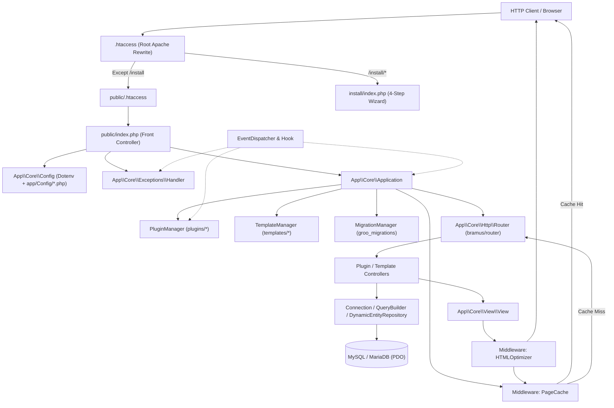

# System Architecture — Groo (`groo/core`)

This document describes the **verified runtime architecture** of Groo (`groo/core`), derived directly from the source code under `app/`, `plugins/`, `templates/`, `public/`, and `install/`.

---

## 1. High-Level Architecture

Groo follows a modular front-controller architecture built around a lightweight PHP 8.0+ core (`app/Core/`) that delegates domain features to PSR-4 plugins (`plugins/`) and storefront presentation to a single active template (`templates/`).

---

## 2. Core Kernel (`app/Core/`)

| Component | Path | Responsibility |
|---|---|---|
| **Application** | `app/Core/Application.php` | Boots configuration, timezone, router, plugins, active template, auto-migrations, and request/cache/optimizer pipeline. |
| **Config** | `app/Core/Config.php` | Loads `.env` via `vlucas/phpdotenv` (`createUnsafeMutable()->safeLoad()`) and all PHP config files in `app/Config/`, exposing dot-notation access (`Config::get('app.debug')`). |
| **Router** | `app/Core/Http/Router.php` | Wraps `Bramus\Router\Router` with `{param:regex}` compilation, route groups, middleware pipelines (`array_reduce`), `Class@method` dispatch, and 404 → `NotFoundException`. |
| **ApiResponse** | `app/Core/Http/ApiResponse.php` | Standard JSON response envelope (`success`, `message`, `data`, `meta`). |
| **View** | `app/Core/View/View.php` | PHP template engine supporting layout inheritance (`extend`, `section`, `endSection`, `yieldSection`), partials, components, HTML escaping (`e()`), URL helpers (`route()`, `asset()`, `media()`), `ADMIN_PATH` rewriting, and `records($slug)`. |
| **Connection** | `app/Core/Database/Connection.php` | Lazy singleton `PDO` connection for MySQL (`utf8mb4`, exceptions enabled, emulated prepares disabled). |
| **QueryBuilder** | `app/Core/Database/QueryBuilder.php` | Minimal fluent SQL builder (`select`, `where`, `orWhere`, `whereIn`, `orderBy`, `limit`, `offset`, `insert`, `update`, `delete`). |
| **DynamicEntityRepository** | `app/Core/Database/DynamicEntityRepository.php` | JSON-backed EAV entity store (`entities`, `attributes`, `entity_records`) with typed schema validation and MySQL `JSON_EXTRACT` lookup. |
| **MigrationManager** | `app/Core/Database/MigrationManager.php` | Tracks applied numbered migrations per `scope` in `groo_migrations` and executes `up(PDO $pdo)`. |
| **PluginManager** | `app/Core/Plugin/PluginManager.php` | Discovers `plugins/<Name>/<Name>Plugin.php`, filters by `ACTIVE_PLUGINS`, topologically sorts `requires` dependencies, invokes `register()`, loads routes, and runs `boot()`. |
| **TemplateManager** | `app/Core/Template/TemplateManager.php` | Loads `ACTIVE_TEMPLATE`, checks required plugins from `template.php`, mounts view base path, registers template routes plus `/assets/{file:.+}` and `/media/view/{file:.+}` asset servers. |
| **EventDispatcher & Hook** | `app/Core/Events/EventDispatcher.php`, `app/Core/Hook.php` | Two extensibility registries: `EventDispatcher` (singleton pub/sub, descending priority via `krsort`) and `Hook` (WordPress-style actions/filters, ascending priority via `ksort`, used by `UserManagement`). |
| **Exceptions\Handler** | `app/Core/Exceptions/Handler.php` | Converts PHP errors into `ErrorException`, logs exceptions, dispatches `core.exception.render` for HTML views (handled by `ErrorPages`), and falls back to JSON `ApiResponse::error()`. |
| **PageCache & HTMLOptimizer** | `app/Core/Middleware/PageCache.php`, `HTMLOptimizer.php` | Experimental response middleware for full-page HTML caching (`storage/cache/html/`) and HTML image/script optimization. |

---

## 3. Request Lifecycle

1. **Apache Rewrite:** `.htaccess` denies direct access to internal directories (`app/`, `plugins/`, `templates/`, `vendor/`, `storage/`, `docs/`, `.git/`) and rewrites all non-`/install` requests to `public/index.php`.
2. **Front Controller (`public/index.php`):** Loads Composer autoloader and `Config`, redirects to `/install` if `APP_INSTALLED` is falsy, registers `Handler`, and invokes `Application::create()->boot()->run()`.
3. **Boot Sequence (`Application::boot()`):**
   - Configures timezone, base path, and `Router`.
   - Loads and registers active plugins (`PluginManager`), then active template (`TemplateManager`).
   - If `AUTO_MIGRATE=true`, runs `MigrationManager` for core, active plugins, and active template.
   - Registers plugin and template routes, calls `boot()` on plugins and template, and dispatches `app.booted`.
4. **Execution (`Application::run()`):**
   - Checks `PageCache` for eligible `GET` requests (excluding admin, `/api`, `/install`, and logged-in admins).
   - Dispatches route inside an output buffer (`ob_start()`).
   - Passes rendered HTML through `HTMLOptimizer` (non-admin/api/install responses `>= 100` bytes containing `<html`).
   - Persists cacheable `< 400` responses in `PageCache` and outputs HTML.

---

## 4. Plugin Architecture (`plugins/`)

Every plugin implements `App\Core\Plugin\PluginInterface` (typically extending `AbstractPlugin`) and exposes metadata (`name`, `slug`, `version`, `description`, `requires`, `route_prefix`).

| Plugin | Role | Primary Storage |
|---|---|---|
| `Admin` | Admin panel layout, auth/sessions, dashboard, generic dynamic entity CRUD, plugin toggle, ZIP theme/plugin installer | `um_users`, `um_roles`, `um_user_roles`, `um_login_attempts`, `entities`, `entity_records`, `.env` |
| `Content` | Block-based blog/post CMS (text, image, HTML blocks) + public JSON API (`/api/content/posts`) | `entities` / `entity_records` (`post` entity) |
| `Crm` | Contacts + activity timeline, tasks & calendar, task types, invoices/expenses, notifications, dashboard widgets | `crm_contact` entity, `crm_notes`, `crm_tasks`, `crm_task_types`, `crm_invoices`, `crm_notifications` |
| `UserManagement` | User, role, and admin CRUD; Bearer API keys; `user.*` hooks | `um_users`, `um_roles`, `um_user_roles`, `um_api_keys` |
| `Media` | Media library, GD WebP conversion, responsive (`480w`/`768w`) theme asset generator | `media_library`, `public/uploads/` |
| `SEO` | Meta/OG/JSON-LD manager, `/robots.txt` and `/sitemap.xml` endpoints, file cache | `seo_settings`, `seo_meta`, `storage/cache/seo/` |
| `Traffic` | Request/bot logger (`BotDetector`), page quality scoring (`ScoreCalculator`), Chart.js analytics | `traffic_logs`, `page_metrics` |
| `ErrorPages` | Custom HTTP error pages listening on `core.exception.render` | `error_pages` |
| `Demo` | Sample unauthenticated entity/record API & greeting endpoints *(disable in production)* | `contact` entity (and any dynamic entity) |
| `DualContact` | Client-specific contact message inbox paired with `DualTesisat` template | `dual_contact_messages` |
| `Install` | Legacy plugin-based installer (`/system-install/`) *(deprecated; conflicts with `/install`)* | Multiple legacy/seed schemas |

---

## 5. Template Architecture (`templates/`)

Templates implement `App\Core\Template\TemplateInterface` (via `AbstractTemplate`), declare metadata and required plugins in `template.php`, define storefront routes in `routes.php`, and place views in `Views/`.

- `templates/default/` — Minimal standalone welcome page requiring no plugins.
- `templates/DualTesisat/` — Client-specific corporate website template (Turkish plumbing/renovation company) integrating `Content` blog posts and `DualContact` contact forms.

---

## 6. Known Architectural Caveats

For complete line-level evidence and remediation plans, see [`../github-readiness/REPOSITORY_AUDIT.md`](../github-readiness/REPOSITORY_AUDIT.md) and [`../github-readiness/ADDITIONAL_WORK_PACKAGES.md`](../github-readiness/ADDITIONAL_WORK_PACKAGES.md):

1. **Competing Migration Systems:** `install/migrations/` and `plugins/Install/Migrations/` both target `scope='install'` with diverging schemas, while `app/Database/Migrations/` referenced by `Application` and `composer.json` does not exist.
2. **Tight Admin Coupling:** Several plugins (`Content`, `Crm`, `DualContact`, `ErrorPages`) depend on `Admin` classes without declaring `'requires' => ['admin']` and hardcode `/admin` route prefixes instead of using `AdminPaths`.
3. **Dual Hook Systems:** `EventDispatcher` (descending priority) and `Hook` (ascending priority) coexist with inverted priority semantics.
4. **Static Sidebar Navigation:** `plugins/Admin/Views/components/admin-sidebar.php` hardcodes plugin navigation links rather than rendering from `AdminMenuRegistry`.
